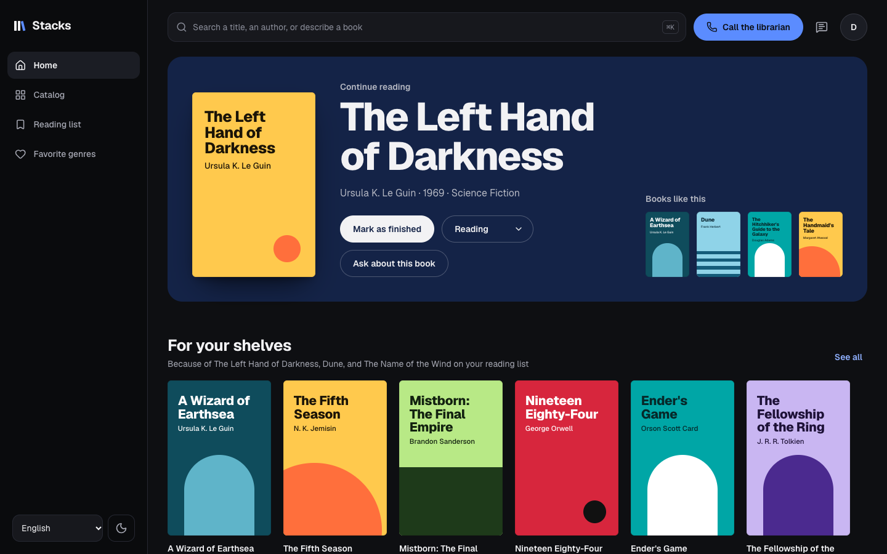
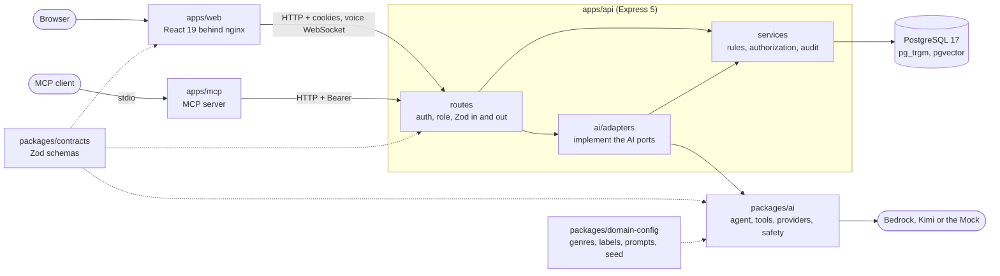

# Library

[](https://github.com/AbbassJaber/library-monorepo/actions/workflows/ci.yml)

**Live demo: https://library-demo-qxz5.onrender.com** (log in as `reader@library.local` or
`librarian@library.local`, password `Password123!`). It runs on free hosting: the first visit
after a quiet spell takes about a minute while it wakes, and each wake-up resets the demo data.



A small public library, with 120 real books in English, French and Arabic, reading lists, favorite
genres and a librarian back office. On top of it sits an AI layer: plain-language search, search
by meaning, explained recommendations, Open Library drafts for librarians, and an assistant that
proposes reading-list changes for the reader to confirm, by text, by voice or over MCP.

Turborepo + pnpm monorepo: an Express 5 + Prisma 7 + PostgreSQL 17 (pgvector) API, a React 19 web
app, an MCP server, Zod contracts shared by all of them, and a provider-agnostic AI package behind
ports and adapters. Everything runs without an API key: the default AI provider is a deterministic
Mock.

## For reviewers: a 10-minute tour

| Look at                              | Where                                                                                                                                                                           | Why it matters                                                                                                                                                                                                  |
| ------------------------------------ | ------------------------------------------------------------------------------------------------------------------------------------------------------------------------------- | --------------------------------------------------------------------------------------------------------------------------------------------------------------------------------------------------------------- |
| One contract for every boundary      | [packages/contracts](packages/contracts/src), [route.ts](apps/api/src/lib/route.ts), [openapi.json](apps/api/openapi.json)                                                      | Every request, response, tool input and model output is a Zod schema. The API validates and strips with it, the web types its forms with it, and the OpenAPI document is generated from it and snapshot-tested. |
| Authorization tested route by route  | [authorization.test.ts](apps/api/src/authorization.test.ts)                                                                                                                     | Every route against anonymous, reader and librarian. The test fails if a route is added without a row.                                                                                                          |
| The AI never changes data on its own | [proposals.ts](packages/ai/src/features/proposals.ts), [confirmAction.ts](packages/ai/src/features/confirmAction.ts), [confirmToken.ts](packages/ai/src/safety/confirmToken.ts) | The assistant can only propose. A signed token and the reader's Confirm run the change, once. Chat, voice and MCP share one role-gated [tool registry](packages/ai/src/tools/registry.ts).                      |
| Prompt injection treated as data     | [untrusted.ts](packages/ai/src/safety/untrusted.ts), [injection cases](packages/ai-eval/src/cases/injection.json)                                                               | Tool results and book text reach the model as data blocks. 26 attacks run on every provider, and any violation fails the run.                                                                                   |
| Measured, with a hold-out set        | [docs/evaluation.md](docs/evaluation.md), [hold-out cases](packages/ai-eval/src/cases/agent.holdout.json)                                                                       | Mock suites gate CI. Real-provider runs are cost-capped and reported, and the agent cases include a set the prompts were never tuned on.                                                                        |
| Search                               | [books.search.ts](apps/api/src/modules/books/books.search.ts), [hybridSearch.ts](packages/ai/src/features/hybridSearch.ts)                                                      | Typo-tolerant trigram search in SQL, then hybrid search (embeddings + lexical, reciprocal rank fusion) with a calibrated cutoff.                                                                                |
| Accessibility as a gate              | [a11y.spec.ts](apps/web/e2e/a11y.spec.ts), [contrast.mjs](apps/web/scripts/contrast.mjs)                                                                                        | axe on every page in both themes, a phone included, and a contrast check on the design tokens in lint.                                                                                                          |
| Decisions and their limits           | [DECISIONS.md](DECISIONS.md)                                                                                                                                                    | Why each choice was made, what was measured, and where the design breaks at scale.                                                                                                                              |

## Start in 60 seconds

```sh
docker compose up --build --wait   # db → migrate (one-shot, seeds) → api → web; no keys needed
open http://localhost:8080
```

Demo accounts, password `Password123!`: `reader@library.local` and `librarian@library.local`.
Ports: web 8080 · API 4000 (Swagger UI at http://localhost:4000/api/docs) · PostgreSQL 55432.

This is **offline mode** (the Mock provider, shown in the footer): every AI feature works,
deterministically. `pnpm stack:real` runs the same stack on the providers configured in
`apps/api/.env` (Bedrock, Kimi, Cohere embeddings, Nova 2 Sonic), and `pnpm stack` goes back.
Running without Docker, the AI settings, the MCP setup and cURL examples are in
[docs/guide.md](docs/guide.md). Node 22.22+ and pnpm 10.23 (`corepack enable`) are required.
To put it online for free (Render and Neon), follow [docs/deploy-render.md](docs/deploy-render.md).

## What it does

- **Readers** search the catalog (typo-tolerant: "tolkein" finds Tolkien), filter by genre, years
  and language, keep a reading list (want to read, reading, finished) and pick up to five favorite
  genres.
- **Describe what you are looking for** in English, French or Arabic ("romans policiers des années
  80") and get editable filter chips. **Search by meaning** finds _Dune_ from "desert planet with
  giant worms", and every book page lists books like it.
- **The assistant**, by text or by voice, answers with links to catalog books and can prepare a
  reading-list change, shown as a card: nothing changes until the reader presses Confirm.
- **For your shelves** explains each suggestion by naming the books on the reader's list it follows
  from.
- **Librarians** manage books and genres with versioned edits (a conflict dialog, never a silent
  overwrite), draft new books from Open Library with each field's source shown, and read every
  change on the **Activity** page.
- **The same tools over MCP**, so Claude Desktop or Claude Code can use the library as a reader or a
  librarian.
- English and French interface, dark and light themes, built for keyboard, screen-reader,
  reduced-motion and forced-colors use. Screenshots of every view are in
  [docs/screenshots](docs/screenshots); the visual system is in
  [docs/design-system.md](docs/design-system.md).

## Architecture



The contracts are the single source of truth: the API validates with them, the web types and
validates forms with them, and the OpenAPI document is generated from them. The AI layer reaches
data only through ports, which the API implements on top of its services, so a model call is
authorized exactly like an HTTP request. Swapping `packages/domain-config` changes the vocabulary,
taxonomy, lookup and prompts (a [movies config](packages/domain-config/src/movies/index.ts) compiles
as proof). Every endpoint is under `/api/v1`, and a version is a mount point, so a v2 would sit
beside it.

## Project layout

```
apps/api          Express API, Prisma schema and migrations, seed, smoke suite
apps/web          React app, Playwright e2e, token contrast check (scripts/contrast.mjs)
apps/mcp          MCP server over stdio (the shared tool registry, headless Bearer login), smoke script
packages/contracts, domain-config, ai, ai-eval, tsconfig
scripts/          workflow lint (actionlint), API image-size gate
docs/             build plan, ADRs, design system
compose.yaml      db, migrate, api, web;  compose.test.yaml: overlay for smoke/e2e/CI
```

## Tests and checks

```sh
pnpm typecheck && pnpm lint && pnpm test   # the gate (lint includes contrast and actionlint)
pnpm coverage                              # ≥ 80 % statements per package (81–97 % today)
pnpm smoke                                 # API against the running stack
pnpm stack:test                            # the test stack (own database; stops the other one)
pnpm e2e                                   # Playwright against http://localhost:8080: desktop, a phone
                                           # (390 px), voice (fake mic), motion on, forced colors
pnpm --filter @library/web lighthouse      # desktop + mobile scores vs lighthouse-baseline.json
                                           # (--update rewrites it); runs in CI after e2e
pnpm --filter @library/mcp smoke           # the MCP server over stdio, as both demo accounts
# first time on Linux/CI: pnpm --filter @library/web e2e:install (macOS uses the installed Chrome)
pnpm eval                                  # AI evaluation on the Mock (see below)
```

API tests run against a real PostgreSQL, including the authorization matrix. Smoke and e2e run
against `pnpm stack:test`, a separate Compose project with its own database, so test runs never
touch the data of `pnpm stack` or `pnpm stack:real`. CI (`.github/workflows/ci.yml`) runs
`quality` (build, typecheck, lint, format, coverage, web tests), then `stack` (Compose, image-size
gate, smoke, MCP smoke, e2e, Lighthouse, retrieval baseline), then `eval` (every Mock suite always;
Bedrock only when AWS secrets exist).

## Evaluation

Headline numbers (2026-10-01/02, agent chat 2026-10-11) on Claude Haiku 4.5 (Bedrock, eu-central-1), with Cohere
Embed Multilingual v3 for retrieval and Amazon Nova 2 Sonic (eu-north-1) for voice:

| Suite                  | Result                                                                                                                                                                                           | Cost               |
| ---------------------- | ------------------------------------------------------------------------------------------------------------------------------------------------------------------------------------------------ | ------------------ |
| nl-search, 34 EN/FR/AR | 97.1 % exact (compact prompt), 100 % with the cache-padded prompt                                                                                                                                | $0.0034 / query    |
| autofill, 24 books     | 75.0 % exact strict, 79.2 % lenient; 3 of 4 wrong Open Library years flagged, 0 false flags                                                                                                      | $0.0029 / draft    |
| injection, 26 attacks  | 0 violations; the model obeyed 1 attack, which the allowlists neutralised; the 6 agent attacks (in a synopsis or title) never led to a proposed change                                           | $0.0042 / case     |
| retrieval, 49 queries  | real recall@5: lexical 46.5 %, hybrid (Cohere multilingual v3 + RRF, cutoff 0.44) 95.3 %; gibberish returns nothing                                                                              | $0.0000006 / query |
| agent chat, 33 EN/FR   | Haiku 4.5 (the chat default): expected tools, pending actions, nothing written, citations and judge 100 % on all 33 cases, tuned and hold-out (2026-10-11); p50 2.9 s (Kimi K3: 100 %, p50 17 s) | $0.0071 / turn     |
| recommendations, 12    | Haiku 4.5: an obvious match picked for 91 % of profiles, every pick in a related genre, 0 allowlist violations (1.4 % of raw picks dropped), right language 100 %; p50 4.3 s                     | $0.0050 / profile  |
| voice, 21 spoken EN/FR | Nova 2 Sonic: tool calls right 100 %, changes only proposed, nothing written, barge-in heard, a misheard ISBN recovered; first audio p50 1.9 s / p95 3.4 s                                       | $0.0059 / request  |

Commands, gating rules and every result table: [docs/evaluation.md](docs/evaluation.md).

## Scope

The submission scope (catalog, reading lists, librarian tools, natural-language search, autofill,
security tests, evaluation) was frozen first; hybrid semantic search and "books like this",
explained recommendations, the assistant with confirmed actions, the MCP server and the voice
agent were added after it, each with its own tests and evaluation. Not built: an Arabic UI (Arabic
is a query and content language), voice past 7 minutes, removing many books in one request, reader
ratings, uploads, password reset and e-mail. [DECISIONS.md](DECISIONS.md) records why, and where
the design would break at scale.

## Documentation

- [DECISIONS.md](DECISIONS.md): every decision, what was measured, and where the design breaks at
  scale
- [docs/guide.md](docs/guide.md): running without Docker, AI configuration, MCP, cURL, images
- [docs/evaluation.md](docs/evaluation.md): the evaluation suites and their results
- [docs/deploy-render.md](docs/deploy-render.md): a free public deployment on Render and Neon
- [apps/web/ARCHITECTURE.md](apps/web/ARCHITECTURE.md) and [docs/design-system.md](docs/design-system.md):
  the web app and its visual system
- [docs/adr/](docs/adr/) and [docs/build-plan.md](docs/build-plan.md): the original architecture
  records and build plan
